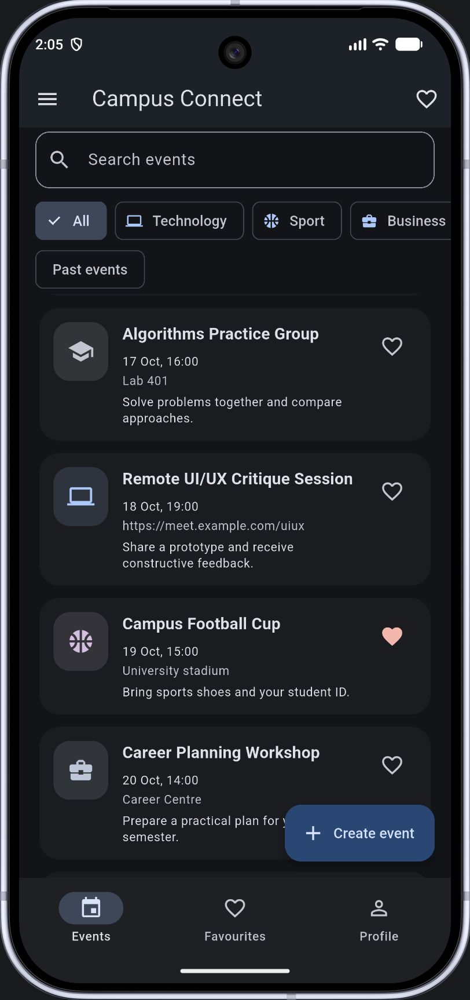
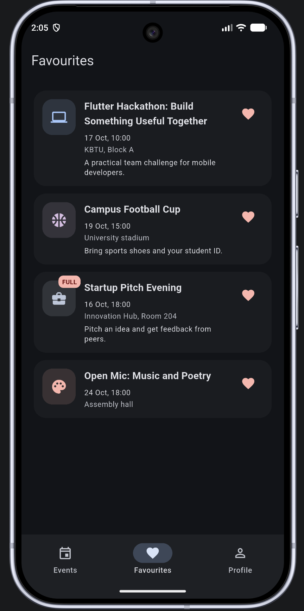
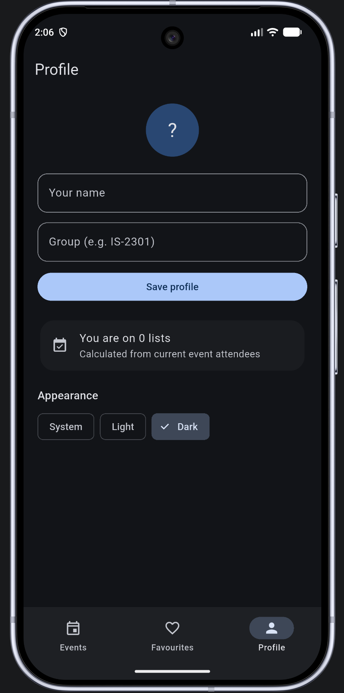

# 🎓 Campus Connect

**Every campus event. One app. Zero confusion.**

A Flutter app built for Mobile Development Lab 1, and honestly, it turned into something I actually enjoy opening.

---------------------------------------------------------------------------------------------------------------

## The idea

Campus life throws events at you from a dozen directions: posters, group chats, that one friend who always knows what's happening. Campus Connect puts them all in a single list.

Each event carries a title, a category, a start date, a location or an online link, a capacity, the current attendee count, an optional description, and whether you've starred it.

That's it. No accounts, no server, no waiting. Just the events, laid out clean.

---------------------------------------------------------------------------------------------------------------

## What it does

🔍 **Search and filter.** Find events by name, or narrow down by category and past or upcoming.

📱 **Adapts to your screen.** A list on your phone, a grid on a tablet. Same data, different shape.

⏳ **Countdown on the detail screen.** Because "starts in 2 hours" hits differently than a date.

✅ **Register. Cancel. Repeat.** Sign up for an event, back out if plans change.

✏️ **Create, edit, delete.** Full control over your own events.

⭐ **Favourites.** Star the ones you care about and keep them close.

👤 **Your profile, your theme.** Pick light or dark. It remembers.

🔄 **Reset data.** One tap back to a clean slate.

💾 **Everything in memory.** Fast, simple, and exactly what the lab asks for.

---------------------------------------------------------------------------------------------------------------

## Running it

```bash
flutter pub get
flutter run
```

That's the whole setup. Flutter installed, three commands, app running.

---------------------------------------------------------------------------------------------------------------

## Decisions I made

The event list and the profile live in the shell state, so every tab reads from one source of truth. The detail screen gets the selected event plus a set of callbacks, which is how changes travel back up to the shell.

The form returns its result through the route. That way, backing out of the form leaves the original list untouched. No half-finished edits sneaking in.

For layout, I reached for `LayoutBuilder`. Device labels tell you what the hardware is called, not how much room you actually have. Constraints are the honest answer.

`PopScope` compares the current form values against the ones present when the form opened, so the app only warns you when there's something real to lose.

All data stays in memory. Networking and persistence sit outside the scope of this lab, and I'd rather finish a clean small thing than a half-wired big one.

With later-week tools, I'd add tests and persistence, but only when the course allows it.

---------------------------------------------------------------------------------------------------------------

## Screenshots

> Drop these in before submission.





Built for Mobile Development Lab 1. Runs on Flutter, lives in memory, and gets out of your way.